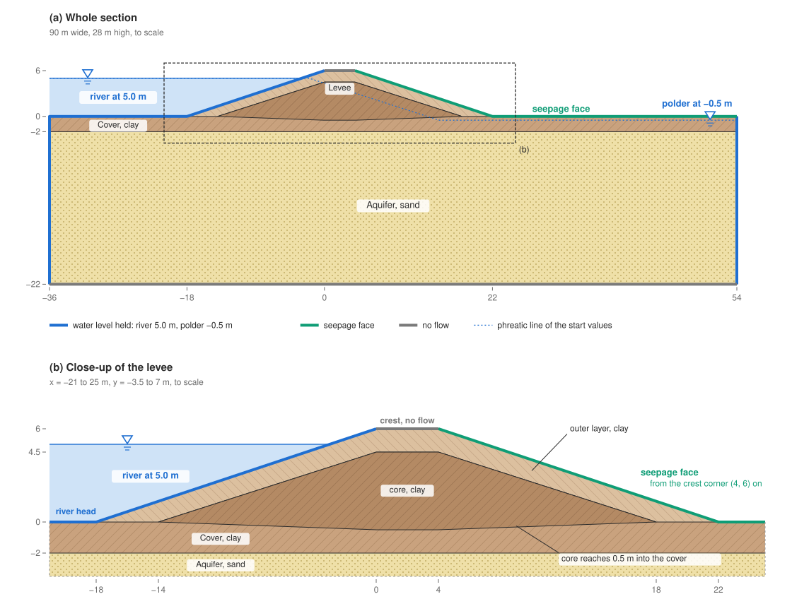

# Build the levee seepage model in `kratos-cli`

A steady-state groundwater flow calculation of the flow under and through a clay levee, built and run from
the command line in PowerShell. Following the commands to build the example model will give the same results as running the python script
[`examples/levee_seepage/levee_seepage.py`](../../examples/levee_seepage/levee_seepage.py):
the Kratos input files they write are identical.

The ready-made model is in
[`examples/levee_seepage/`](../../examples/levee_seepage/README.md).

Before you start, prepare PowerShell as described in
[Prepare PowerShell for the tutorials](../INSTALLATION.md#prepare-powershell-for-the-tutorials).
Every command below can then be pasted as it is. Each command is in a block of its own,
which the copy button copies ready to run; what `kratos-cli` prints in reply follows it,
indented behind a quote bar and without a copy button.

## What you build

A 2D plane-strain section, 90 m wide and 28 m high, in SI units (m, N, Pa, kg/m³):




- A sand aquifer from y = −22 to −2 m and a clay cover from −2 to 0 m, across the section.
- A clay levee on the cover, drawn as two polygons: a core, which reaches 0.5 m into the
  cover, and an outer layer around it, with its crest from (0, 6) to (4, 6).
- The river, at 5.0 m, holds the left side, the foreland and the outer slope; the right
  side is held at the polder level, −0.5 m. The inner slope and the polder surface are a
  seepage face. The crest and the bottom are closed.
- One stage of the type Groundwater flow. There is no construction sequence, so this
  tutorial does not go into stages.

## Step 1. The project and the section

```powershell
kratos-cli new levee.json --force --dim 2 --name levee_seepage
```
> <pre>wrote levee.json: levee_seepage (2D section at z = 0, SI)</pre>

```powershell
kratos-cli domain levee.json --x -36 54 --y -22 6
```
> <pre>domain x -36 .. 54, y -22 .. 6 (2D section at z = 0); wrote levee.json</pre>

The name `levee_seepage` also names the deck's files (`levee_seepage.mdpa`).

## Step 2. The water and the soils

The water in the soils' pores is the project's, one for every soil. Its unit weight is
the water level's specific weight, 10 kN/m³ in a new project, so Kratos gets a water
density of 10 000 / 9.81 ≈ 1019.37 kg/m³. Its bulk modulus and viscosity are
set here; the water is taken as incompressible:

```powershell
kratos-cli fluid levee.json --bulk-modulus 1e20 --viscosity 1e-3
```
> <pre>Water in every soil: bulk modulus 1e+20 Pa, viscosity 0.001 Pa·s, density 1019.37 kg/m³ (the water level's specific weight over g). wrote levee.json</pre>

All four soil bodies share one set of flow properties, as in the model script:

| Property | Value |
|---|---|
| saturated hydraulic conductivity K | 1 m/day, isotropic |
| `PERMEABILITY_XX`, `_YY` | K μ / (ρw g) ≈ 1.157e-12 m², with the water's viscosity μ = 1e-3 Pa s and unit weight ρw g = 10 kN/m³ |
| `RETENTION_LAW` | `VanGenuchtenLaw` |
| `VAN_GENUCHTEN_AIR_ENTRY_PRESSURE` | 10 000 / ga ≈ 2611 Pa, with ga = 3.83 1/m |
| `VAN_GENUCHTEN_GN`, `_GL` | 1.377, 1.25 |
| `RESIDUAL_SATURATION` | 0.06203 |
| `MINIMUM_RELATIVE_PERMEABILITY` | 1e-4 |

Only the permeability and the retention law, with the water's viscosity and density,
change the flow. Kratos' flow element checks that the other values, such as Young's
modulus and Poisson's ratio, are there. The table rounds the values. The commands below
type them out in full, so they are the script's to the last digit.

```powershell
kratos-cli material levee.json add m_sand --name Sand --color "#e6c86e" --law GeoLinearElasticPlaneStrain2DLaw GEO_DRAINAGE_TYPE=FULLY_COUPLED YOUNG_MODULUS=1e4 POISSON_RATIO=0.3 DENSITY_SOLID=2650.0 POROSITY=0.3333 BULK_MODULUS_SOLID=1e20 PERMEABILITY_XX=1.1574074074074074e-12 PERMEABILITY_YY=1.1574074074074074e-12 PERMEABILITY_XY=0.0 BIOT_COEFFICIENT=1.0 RETENTION_LAW=VanGenuchtenLaw SATURATED_SATURATION=1.0 RESIDUAL_SATURATION=0.06203 VAN_GENUCHTEN_AIR_ENTRY_PRESSURE=2610.9660574412533 VAN_GENUCHTEN_GN=1.377 VAN_GENUCHTEN_GL=1.25 MINIMUM_RELATIVE_PERMEABILITY=1e-4
```
> <pre>added material m_sand; wrote levee.json</pre>

```powershell
kratos-cli material levee.json add m_clay --name Clay --color "#8fa37a" --law GeoLinearElasticPlaneStrain2DLaw GEO_DRAINAGE_TYPE=FULLY_COUPLED YOUNG_MODULUS=1e4 POISSON_RATIO=0.3 DENSITY_SOLID=2650.0 POROSITY=0.3333 BULK_MODULUS_SOLID=1e20 PERMEABILITY_XX=1.1574074074074074e-12 PERMEABILITY_YY=1.1574074074074074e-12 PERMEABILITY_XY=0.0 BIOT_COEFFICIENT=1.0 RETENTION_LAW=VanGenuchtenLaw SATURATED_SATURATION=1.0 RESIDUAL_SATURATION=0.06203 VAN_GENUCHTEN_AIR_ENTRY_PRESSURE=2610.9660574412533 VAN_GENUCHTEN_GN=1.377 VAN_GENUCHTEN_GL=1.25 MINIMUM_RELATIVE_PERMEABILITY=1e-4
```
> <pre>added material m_clay; wrote levee.json</pre>

```powershell
kratos-cli material levee.json list
```
> <pre>m_sand  Sand  Linear elastic (GeoLinearElasticPlaneStrain2DLaw), 17 variables
> m_clay  Clay  Linear elastic (GeoLinearElasticPlaneStrain2DLaw), 17 variables</pre>

> [!TIP]
> Write `2650.0`, `1.0` and `0.0`, not `2650`, `1` and `0`: a whole number is kept as
> one, and the deck then says `2650` where the script's says `2650.0`. Kratos reads both
> the same; the files only differ in that.

## Step 3. The layers

The first layer starts at the top of the domain (here the top of the dike at 6 m), so the cover's top is moved down to
the ground surface at 0 m. The levee comes on top of it in step 4.

```powershell
kratos-cli layer levee.json add cover --name Cover --material m_clay --bottom -2
```
> <pre>added layer cover; wrote levee.json</pre>

```powershell
kratos-cli layer levee.json set cover --top 0
```
> <pre>changed layer cover; wrote levee.json</pre>

```powershell
kratos-cli layer levee.json add aquifer --name Aquifer --material m_sand --bottom -22
```
> <pre>added layer aquifer; wrote levee.json</pre>

```powershell
kratos-cli layer levee.json list
```
> <pre>cover  Cover  of m_clay: 0 .. -2
> aquifer  Aquifer  of m_sand: -2 .. -22</pre>

## Step 4. The levee

The levee is created by drawing two polygons drawn in the section, each a soil body of clay. The core runs
from (−14, 0) up to 4.5 m and down to (18, 0), and reaches 0.5 m into the cover; a drawn
part takes the place of the layer it overlaps. The outer layer wraps the core, from
(−18, 0) over the crest to (22, 0):

```powershell
kratos-cli volume levee.json add polygon --label "Levee core" --material m_clay --points -14 0 0 4.5 4 4.5 18 0 4 -0.5 0 -0.5
```
> <pre>added drawn_0 (Levee core, soil of m_clay); wrote levee.json</pre>

```powershell
kratos-cli volume levee.json add polygon --label "Levee outer layer" --material m_clay --points -18 0 0 6 4 6 22 0 18 0 4 4.5 0 4.5 -14 0
```
> <pre>added drawn_1 (Levee outer layer, soil of m_clay); wrote levee.json</pre>

`volume add` names the drawn parts `drawn_0`, `drawn_1`, and so on. It gives each part the
color of its material and keeps the label. The model script names the parts `levee_core`
and `levee_outer` and colors them gray. The next four commands give the parts the same
names and color as in the script:

```powershell
kratos-cli set levee.json "custom_parts[drawn_0].key" levee_core
```
> <pre>custom_parts[drawn_0].key = "levee_core"; wrote levee.json</pre>

```powershell
kratos-cli set levee.json "custom_parts[drawn_1].key" levee_outer
```
> <pre>custom_parts[drawn_1].key = "levee_outer"; wrote levee.json</pre>

```powershell
kratos-cli set levee.json "custom_parts[levee_core].color" "#888888"
```
> <pre>custom_parts[levee_core].color = "#888888"; wrote levee.json</pre>

```powershell
kratos-cli set levee.json "custom_parts[levee_outer].color" "#888888"
```
> <pre>custom_parts[levee_outer].color = "#888888"; wrote levee.json</pre>

```powershell
kratos-cli parts levee.json
```
> <pre>soil_cover  Cover
> soil_aquifer  Aquifer
> levee_core  Levee core (soil of m_clay)
> levee_outer  Levee outer layer (soil of m_clay)</pre>

The `key` is the name that the stages and the deck's part names use; the `color` is only
for display.

## Step 5. The water

A new project has standard supports that block the normal movement of sides by rollers and fix the bottom motion in all directions.
A groundwater flow calculation, like this levee case, does not make use of them. The front and back rollers are there
for a 3D model and are not listed in 2D:

```powershell
kratos-cli boundary levee.json list
```
> <pre>fixed_bottom  Fixed bottom  displacement on the bottom face; fixed in x y z
> roller_left  Roller left  displacement on the left face; fixed in x
> roller_right  Roller right  displacement on the right face; fixed in x
> The front and back supports are kept for the solid model; the 2D section holds z by itself.</pre>

The riverside boundary condition specifies the water level in the river and includes the left side, the foreland and the outer slope up to the crest's outer
corner, all as one line that connects the line pieces. The polder side boundary condition specifies the far field groundwater level in the polder on the right side:

```powershell
kratos-cli boundary levee.json add river_head --name "River head" --line -36 -22 -36 0 -18 0 0 6 --water-pressure Hydrostatic --reference-coordinate 5 --pressure-tension-cut-off 1e5
```
> <pre>added river_head  River head  water pressure on line (-36, -22) -&gt; (-36, 0) -&gt; (-18, 0) -&gt; (0, 6); hydrostatic about 5 m, cut-off 100000, fixed; wrote levee.json</pre>

```powershell
kratos-cli boundary levee.json add polder_head --name "Polder head" --line 54 0 54 -22 --water-pressure Hydrostatic --reference-coordinate -0.5 --pressure-tension-cut-off 1e5
```
> <pre>added polder_head  Polder head  water pressure on line (54, 0) -&gt; (54, -22); hydrostatic about -0.5 m, cut-off 100000, fixed; wrote levee.json</pre>

`--pressure-tension-cut-off 1e5` lets the suction above each level grow to 100 kPa. The
river head also holds the outer slope above 5.0 m, up to the crest, where it is 10 kPa of
suction.

The water may leave the soil through the inner slope and the polder surface, from the
crest's inner corner (4, 6) on. This is specified by adding a `seepage_face`

```powershell
kratos-cli boundary levee.json add seepage_face --name "Seepage face" --seepage --line 4 6 22 0 54 0
```
> <pre>added seepage_face  Seepage face  seepage on line (4, 6) -&gt; (22, 0) -&gt; (54, 0); water may leave the soil here; wrote levee.json</pre>

The crest, from (0, 6) to (4, 6), and the bottom have no boundary condition specified, so no water flows
through them.

The flow is nonlinear, because of the Van Genuchten retention law and the seepage face, and the
nonlinear iteration strategy starts from a given initial field for the water pressure. These are hydrostatic below a phreatic line that
drops through the levee from the river level to the polder level. `--initial` makes them
start values only, which the calculation then changes:

```powershell
kratos-cli boundary levee.json add start --name "Start values" --domain --water-pressure Phreatic_Multi_Line --phreatic-line -36 5 -2 5 15 -0.5 54 -0.5 --pressure-tension-cut-off 1e5 --initial
```
> <pre>added start  Start values  water pressure on the whole soil; phreatic line (-36, 5) -&gt; (-2, 5) -&gt; (15, -0.5) -&gt; (54, -0.5), cut-off 100000, initial; wrote levee.json</pre>

```powershell
kratos-cli boundary levee.json list
```
> <pre>fixed_bottom  Fixed bottom  displacement on the bottom face; fixed in x y z
> roller_left  Roller left  displacement on the left face; fixed in x
> roller_right  Roller right  displacement on the right face; fixed in x
> river_head  River head  water pressure on line (-36, -22) -&gt; (-36, 0) -&gt; (-18, 0) -&gt; (0, 6); hydrostatic about 5 m, cut-off 100000, fixed
> polder_head  Polder head  water pressure on line (54, 0) -&gt; (54, -22); hydrostatic about -0.5 m, cut-off 100000, fixed
> seepage_face  Seepage face  seepage on line (4, 6) -&gt; (22, 0) -&gt; (54, 0); water may leave the soil here
> start  Start values  water pressure on the whole soil; phreatic line (-36, 5) -&gt; (-2, 5) -&gt; (15, -0.5) -&gt; (54, -0.5), cut-off 100000, initial
> The front and back supports are kept for the solid model; the 2D section holds z by itself.</pre>

The supports stay in the list, but the Groundwater flow stage does not use them, so they
do not change the deck. The last line is printed for every 2D model.

## Step 6. The calculation and the mesh

One stage, of the type Groundwater flow. A new project has one stage, the initial stage,
which is mechanical; it is made the flow stage. The calculation type is chosen in the
initial stage: a later stage cannot be of another type. Kratos' seepage strategy opens or
closes one node of the seepage face per iteration, and the face has about 55 nodes on
this mesh, so the stage allows 300 iterations to allow for opening or closing of all
these nodes and convergence of the water pressure field. The stage converges on the
residual, as the model script's does; a flow stage's own default is the change of the
water pressure. The mesh is made with linear interpolation triangles of 1 m:

```powershell
kratos-cli stages levee.json set initial --name Flow --calculation flow --convergence-criterion residual --max-iterations 300 --tolerance 1e-4
```
> <pre>changed stage initial; wrote levee.json</pre>

```powershell
kratos-cli stages levee.json list
```
> <pre>1  initial  Flow
>      calculation: flow, static</pre>

```powershell
kratos-cli set levee.json mesh.element_size 1
```
> <pre>mesh.element_size = 1; wrote levee.json</pre>

```powershell
kratos-cli set levee.json mesh.order 1
```
> <pre>mesh.order = 1; wrote levee.json</pre>

If a stage allows fewer iterations than its seepage faces have nodes, `export` and
`calculate` warn that it may stop too soon.

## Step 7. Check it

```powershell
kratos-cli check levee.json
```
> <pre>ok: levee_seepage (2D section at z = 0, SI)</pre>

```powershell
kratos-cli show levee.json
```
> <pre>levee_seepage  (levee.json)
>   2D plane strain, SI units, section at z = 0
>   domain      x -36 .. 54, y -22 .. 0
>   materials   m_sand, m_clay
>   layers      cover, aquifer
>   parts       soil_cover, soil_aquifer, levee_core, levee_outer
>   structures  none
>   water       none
>   conditions  fixed_bottom (displacement on the bottom face), roller_left (displacement on the left face), roller_right (displacement on the right face), river_head (water pressure on line (-36, -22) -&gt; (-36, 0) -&gt; (-18, 0) -&gt; (0, 6)), polder_head (water pressure on line (54, 0) -&gt; (54, -22)), seepage_face (seepage on line (4, 6) -&gt; (22, 0) -&gt; (54, 0)), start (water pressure on the whole soil)
>   gravity     on, g = 9.81 m/s²
>   stages      initial
>   mesh        element size 1, order 1</pre>

`show` gives the domain as `y -22 .. 0`: the command line keeps the domain's top at the
top of the first layer, the ground surface. The levee above it is drawn parts, which the
mesher takes as they are, so the mesh and the Kratos input files do not depend on the
domain's top.

## Step 8. Run it

```powershell
kratos-cli calculate levee.json
```
> <pre>run levee_seepage_&lt;YYYY-MM-DD&gt;_&lt;hh-mm&gt; finished in &lt;t&gt; s: 3 files in &lt;your folder&gt;\levee_seepage_&lt;YYYY-MM-DD&gt;_&lt;hh-mm&gt;
> next: kratos-cli results show levee_seepage_&lt;YYYY-MM-DD&gt;_&lt;hh-mm&gt;</pre>

```powershell
kratos-cli results show 1
```
> <pre>levee_seepage_&lt;YYYY-MM-DD&gt;_&lt;hh-mm&gt;  (deck levee_seepage, started &lt;YYYY-MM-DD&gt;T&lt;hh:mm&gt;)
>   complete, SI units, 8 files, 1.0 MB
>     1  Flow                          results</pre>

`calculate` meshes the model, writes the deck into a new run folder and runs Kratos there.
The run folder is in `KRATOS_GUI_RUNS`, the folder you set it to; `1` is the newest run.
The parts in `<...>` differ with every run: `<YYYY-MM-DD>` and `<hh-mm>` are the date and
time the run started, `<t>` is how long it took (about 25 s), and `<your folder>` is the
folder `KRATOS_GUI_RUNS` is set to.


## Step 9. The results

```powershell
kratos-cli results field 1 pw
```
> <pre>Pore pressure (Pa), stage 1 (Flow): -2.70e+5 to 16802 over 2628 nodes
>   min -2.70e+5 at node 9
>   max 16802 at node 16
> `--csv` writes every value.</pre>

```powershell
kratos-cli results field 1 flow_rate
```
> <pre>Nodal water flow rate (+ out) (m³/s/m), stage 1 (Flow): -3.08e-6 to 6.10e-6 over 2628 nodes
>   min -3.08e-6 at node 236
>   max 6.10e-6 at node 15
>   out 3.33e-5, in 3.33e-5, out - in 1.73e-11 m³/s/m
> `--csv` writes every value.</pre>

```powershell
kratos-cli results field 1 effective_saturation
```
> <pre>Effective saturation (-), stage 1 (Flow): 0.4841 to 1.04 over 2628 nodes
>   min 0.4841 at node 16
>   max 1.04 at node 2565
> `--csv` writes every value.</pre>

- Kratos' sign for the water pressure is suction positive. The fixed river head gives compression of
  −270 kPa at the bottom left corner. The largest suction, 16.8 kPa, is in the soil of
  the outer layer at the crest's inner corner (4, 6), where the soil is least saturated.
- `flow_rate` is the water each node takes in (negative) or lets out (positive), per
  meter of the section. The water comes in from the river and leaves through the seepage
  face and the polder side.
- Kratos calculates the saturation at the Gauss points and extrapolates it to the nodes,
  so it can show a little above 1.

What these results mean, and how they compare with a reference calculation of the same
section, is in the example's [README](../../examples/levee_seepage/README.md#the-results).

## The same model as the script

To check that the commands built the model script's model, write the script's model as a
project file and export both:

```powershell
kratos-cli build <repo>\examples\levee_seepage\levee_seepage.py --out script.json
kratos-cli export levee.json --out deck_cli
kratos-cli export script.json --out deck_script
```

The two decks, `levee_seepage.mdpa`, `ProjectParameters.json`, `MaterialParameters.json`
and `kratos_gui_units.json`, are identical: Kratos calculates the same model.

## What to do next

- Change one value and calculate again, for example the river level, or the permeability
  of the cover.
- Type the same commands in `kratos-cli shell`, one per line, without `kratos-cli` and the
  project file: `new levee.json --force --dim 2 --name levee_seepage`, then
  `domain --x -36 54 --y -22 6`, and so on. [CROW_case.md](CROW_case.md) shows how the
  shell works.
- Look up every command in [CLI.md](../CLI.md).


