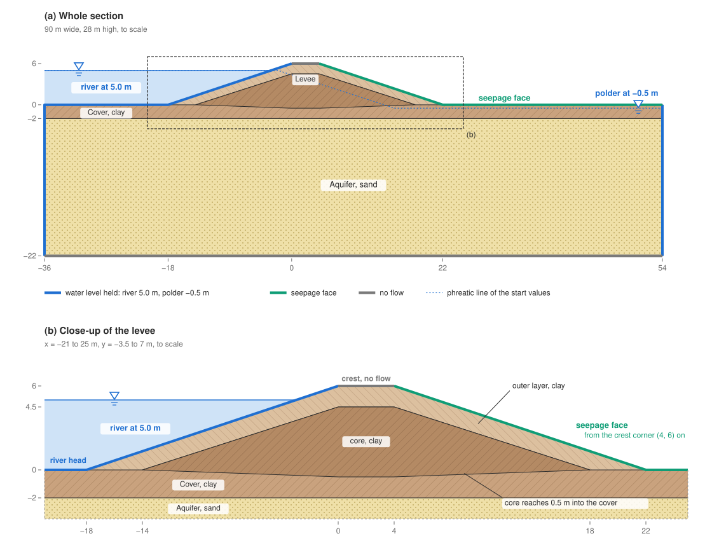

# Build the levee seepage model in the GUI

In this tutorial you build a steady-state groundwater flow under and through a clay levee
in the Styx GUI, from an empty project to the water pressures, the hydraulic head and the
flow in the soil. You use only the windows, the tool rail and the explorers of the GUI. The
tutorial is for a geotechnical engineer who has not used Styx before.

The model is the same model as the
[levee seepage example](https://github.com/Deltares-research/Styx-Kratos-GUI/blob/main/examples/levee_seepage/README.md).

Before you start, install Styx and start it: see
[INSTALLATION.md](https://github.com/Deltares-research/Styx-Kratos-GUI/blob/main/docs/INSTALLATION.md) if you don't have Styx installed already.

Each step has a screenshot. An orange outline on the screenshot shows the button, field or row to use.

## What you build

A 2D plane-strain section, 90 m wide, from y = −22 m up to the crest of the levee at
y = 6 m. All values are in SI units: m, N, Pa and kg/m³. The y axis points up, and the
ground surface is at y = 0.

- A sand aquifer from y = −22 to −2 m and a clay cover from −2 to 0 m, across the section.
- A clay levee on the cover, drawn as two polygons: a core, which reaches 0.5 m into the
  cover, and an outer layer around it, with the crest from (0, 6) to (4, 6).
- The river level is 5.0 m. It holds the left side, the foreland and the outer slope. The
  right side is held at the polder level, −0.5 m. The inner slope and the polder surface
  are a seepage face: water can leave the soil there. No water flows through the crest
  and the bottom.
- One calculation stage of the type Flow (Pw). It calculates only the water pressures, not
  the displacements.

## How to type values

How the GUI takes the values that you type:

- In a window with a **Save**, **Create** or **OK** button, the window keeps your values
  until you click that button. **Cancel** leaves the model as it was.
- In the Soil material window, in the Stages window and in the Selection explorer, a
  value is used when you leave the field (press Tab) or press Enter.
- The decimal sign is a point (`.`). Type a power of ten as `1e20` or `1.1574074074074074e-12`.
- The Styx server keeps the project in its memory. Save it at the end (step 10), or at any
  time with **File** > **Save**.

## Step 1. Start a new project

1. On the toolbar, click **New project** (the first button).
2. In **Project name**, type `levee_seepage`.
3. Click **OK**.

The project name also names the files that Styx writes for Kratos, such as
`levee_seepage.mdpa`. A new project is a 2D section, so the **2D** button on the toolbar is
already selected.

## Step 2. Make the two soils and the water

A soil in Styx is a Kratos material: a constitutive law (the soil model) and its variables.
A groundwater flow calculation uses only the flow properties of a soil. Both soils of this
model have the same values:

| Field | Sand | Clay |
|---|---|---|
| **Identification** | `Sand` | `Clay` |
| **Color** | any, for example `#e6c86e` | any, for example `#8fa37a` |
| **Soil model** | Linear elastic | Linear elastic |
| **Drainage type** | Fully coupled | Fully coupled |
| **Retention law** | VanGenuchtenLaw | VanGenuchtenLaw |
| **Young's modulus** (Pa) | `10000` | `10000` |
| **Poisson's ratio** | `0.3` | `0.3` |
| **Density of the solid** (kg/m³) | `2650` | `2650` |
| **Porosity** | `0.3333` | `0.3333` |
| **Saturated saturation** | `1` | `1` |
| **Residual saturation** | `0.0620347394540943` | `0.0620347394540943` |
| **Air entry pressure** (Pa) | `2610.9660574412533` | `2610.9660574412533` |
| **Pore size distribution index g_n** | `1.3774` | `1.3774` |
| **Intrinsic permeability xx** (m²) | `1.1574074074074074e-12` | `1.1574074074074074e-12` |
| **Intrinsic permeability yy** (m²) | `1.1574074074074074e-12` | `1.1574074074074074e-12` |
| **Minimum relative permeability** | `0.0001` | `0.0001` |
| **Relative permeability exponent g_l** | `1.25` | `1.25` |
| **Bulk modulus of the grains** (Pa) | `1e20` | `1e20` |
| **Biot coefficient** | `1` | `1` |

- **Fully coupled** makes the soil calculate the water pressure. With **Mechanical only**,
  the soil takes the water pressure that you give, and no water flows.
- The saturated hydraulic conductivity K of both soils is 1 m/day. Kratos reads the
  intrinsic permeability k = K · μ / γw, with the viscosity of the water
  μ = 10⁻³ Pa·s and the unit weight of the water γw = 10 kN/m³. That gives
  k = 1.157 × 10⁻¹² m². The window shows the conductivity under each permeability, as
  **Darcy permeability xx** and **yy**.
- The Van Genuchten retention law gives the saturation and the relative permeability of
  the soil above the phreatic line. The air entry pressure is γw / ga,
  with ga = 3.83 1/m.
- A steady flow does not depend on the stiffness, so Young's modulus and Poisson's ratio
  have no effect here. A bulk modulus of the grains of 10²⁰ Pa makes the grains
  incompressible.
- Kratos gets the same input from this tutorial and from the `kratos-cli` tutorial; only
  the order of the soils' values in the deck's materials file differs.

To make the soils:

1. Click the **Soil** tab.
2. On the tool rail, click **Soil materials…**.
3. Click **Create soil**. The Soil material window of the new soil opens.
4. Select the **Drainage type** and the **Retention law** first. They add the fields of
   the flow properties to the window.
5. Type the other values of the sand from the table. Scroll down to see all fields.
6. Click **Close**.
7. Do steps 3 to 6 again for the clay.

The top of the Soil material window of the sand, with the drainage type and the retention
law:

The flow properties of the sand, further down in the same window:

The clay, from the top of its window:

The water in the pores is the same for every soil, so it is a property of the project, not
of a soil. Set it in the Soil materials window, under **Water**:

1. In **Bulk modulus**, type `1e20`. This makes the water incompressible.
2. In **Dynamic viscosity**, type `0.001`.
3. Click **OK**.

The **Unit weight** of the water is 10 kN/m³. Kratos gets the density of the water from it:
10 000 / 9.81 = 1019.37 kg/m³.

## Step 3. Add the soil layers and set the width

The layers are stacked from the ground surface down. The top of the first layer is the
ground surface, y = 0.

| Layer | Material | Bottom (m) |
|---|---|---|
| `Cover` | Clay | `-2` |
| `Aquifer` | Sand | `-22` |

1. On the tool rail, click **Modify soil layers…**.
2. Click **Add** two times. The window adds two layers.
3. For each layer, type the name in **Layer**, select the material, and type the bottom
   level in **Bottom [m]**. The top of each layer follows from the layer above it.
4. Click **OK**.

No window sets the width of the model. Set it in the Selection explorer of a layer:

1. In the Model explorer, click **Cover**.
2. In the Selection explorer, type `-36` in **x min** and press Enter.
3. Type `54` in **x max** and press Enter.

Both layers now run from x = −36 m to x = 54 m.

## Step 4. Draw the levee

The levee is two soil surfaces of clay, drawn on top of the layers. A drawn surface takes
the place of the layer that it overlaps, so the core replaces the cover where it reaches
0.5 m into it.

| Name | Material | Corners (x, y) |
|---|---|---|
| `Levee core` | Clay | (−14, 0), (0, 4.5), (4, 4.5), (18, 0), (4, −0.5), (0, −0.5) |
| `Levee outer layer` | Clay | (−18, 0), (0, 6), (4, 6), (22, 0), (18, 0), (4, 4.5), (0, 4.5), (−14, 0) |

The outer layer wraps the core: its corners go over the outside of the levee from left to
right, and then back along the top of the core.

For each surface:

1. On the tool rail, click **Create soil surface…**.
2. In **Name**, type the name.
3. In **Material**, select **Clay**.
4. Click **Add corner** until the window has as many corners as the table, and type the
   corners in order. The window opens with an example of four corners: type over them.
5. Click **Create**.

The Model explorer now shows the two parts of the levee under the soil layers:

## Step 5. Add the water conditions

A new project already has the displacement conditions: a fixed bottom and rollers on the
sides. A groundwater flow calculation does not use them, so you can leave them.

The water conditions are lines along the outside of the model. A water pressure condition
holds the water pressure on its line; it is hydrostatic about its reference level.

| Name | Condition | Where | Points | Type | Reference level | Tension cut-off |
|---|---|---|---|---|---|---|
| `River head` | Water pressure | Line | `-36 -22, -36 0, -18 0, 0 6` | Hydrostatic | `5` | `100000` |
| `Polder head` | Water pressure | Line | `54 0, 54 -22` | Hydrostatic | `-0.5` | `100000` |
| `Seepage face` | Seepage face | Line | `4 6, 22 0, 54 0` | | | |

- The river head runs up the left side, along the foreland and up the outer slope to the
  outer corner of the crest, as one line.
- The tension cut-off is the largest suction that the condition gives above its reference
  level: 100 kPa. Above the river level, the river head holds the outer slope in suction,
  up to 10 kPa at the crest.
- On the seepage face, water can leave the soil, but it cannot come in. The face starts at
  the inner corner of the crest, (4, 6), and runs down the inner slope and over the polder
  surface.

For each condition:

1. Click the **Flow conditions** tab.
2. On the tool rail, click **Create flow boundary condition…**.
3. In **Name**, type the name.
4. In **Condition**, select the condition, and in **Where**, select **Line**.
5. In **Points**, type the points as in the table: x and y of each point, the points
   separated by commas.
6. For a water pressure: in **Type**, select **Hydrostatic**, and type the **Reference
   level** and the **Tension cut-off**.
7. Click **Save**.

The window of the river head:

The window of the seepage face:

The flow is nonlinear: the Van Genuchten law and the seepage face depend on the water
pressure. Kratos starts the calculation from water pressures that you give. Give it
hydrostatic pressures below a phreatic line that drops through the levee from the river
level to the polder level. These are start values only: the calculation changes them.

1. Open the Create boundary condition window again.
2. In **Name**, type `Start values`.
3. In **Condition**, select **Water pressure**, and in **Where**, select **Whole soil**.
4. In **Type**, select **Phreatic Multi Line**.
5. In **Phreatic line**, type `-36 5, -2 5, 15 -0.5, 54 -0.5`.
6. In **Tension cut-off**, type `100000`.
7. Select **Initial only**.
8. Click **Save**.

## Step 6. Make the mesh

The mesh has linear triangles of 1 m. The seepage face then has about 55 nodes.

1. Click the **Mesh** tab. The Mesh properties window opens. If it does not open, click
   **Mesh properties…** on the tool rail.
2. In **Global element size**, type `1`.
3. In **Element order**, select **Linear · 3-node triangle**.
4. Click **Apply and generate**.

On the computer that made this page, the mesh has 2 628 nodes. Gmsh can make a slightly
different mesh on another computer or operating system, so your numbers can differ a
little.

## Step 7. Make the stage a groundwater flow stage

A new project has one stage, the initial stage. It is a mechanical stage. Make it a
groundwater flow stage:

1. Click the **Staged construction** tab.
2. In the Stages explorer, click **Initial stage**.
3. Click **Stages…**.
4. In **Calculation type**, select **Flow (Pw)**.
5. In **Name**, type `Flow` and press Enter.
6. In **Convergence criterion**, select **Residual**.
7. In **Max iterations**, type `300` and press Enter.
8. Check that **Tolerated error** is `0.0001`.
9. Click **Close**.

- A Flow (Pw) stage calculates only the water pressures. It has no displacements and no
  stresses.
- Kratos' seepage strategy opens or closes one node of the seepage face in each
  iteration. The face has about 55 nodes, so the stage allows 300 iterations to allow for both opening and closing nodes and convergence of the nonlinear flow.
- The residual criterion is the convergence criterion of Kratos' own seepage tests.

## Step 8. Calculate

1. On the toolbar, click **Calculate**. Styx writes the Kratos input files and runs
   Kratos. The calculation takes about half a minute.
2. When the calculation is complete, Styx opens Results mode and the **Choose results**
   window.

3. Click **Close** in the Choose results window.

## Step 9. Look at the water pressure and the flow

1. In the Results explorer, at the bottom right, in **Stage**, select **1 Flow**.
2. In **Field**, select **Groundwater · Pore pressure**.

Kratos' sign for the water pressure is: compression negative, suction positive. The fixed
river head gives −270 kPa at the bottom left corner, and the polder head −215 kPa at the
bottom right. The largest suction, about 17 kPa, is at the inner corner of the crest,
(4, 6), where the soil is driest. The phreatic line, where the pressure is zero, drops
through the levee from the river level and comes out on the inner slope at
x = 19.2 m, y = 0.95 m: the exit point of the seepage face.

3. In **Field**, select **Groundwater · Hydraulic head**.

The head goes from 5.0 m at the river to −0.5 m at the polder. Most of the head drop is naturally located
under and in the levee.

4. In **Field**, select **Groundwater · Effective saturation**.

Below the phreatic line the soil is saturated. Above it, the Van Genuchten law makes the
saturation smaller as the suction grows: in the crest of the levee it is about 0.5. Kratos
calculates the saturation at the integration points and extrapolates it to the nodes, so
it can show a little above 1.

5. In **Field**, select **Groundwater · |q|**. This is the size of the specific discharge,
   the Darcy velocity of the water.

The water comes in from the river, flows through the levee and through the soil under it,
and comes out through the seepage face and the right side. The specific discharge is
largest, about 5 × 10⁻⁶ m/s, in the outer slope just below the river level, where the
water enters the levee. Above the phreatic line, in the dry crest, the water hardly moves.

6. In **Arrows**, select **|q|**. This draws the groundwater flux as arrows over the
   colors: each arrow starts at a node and points in the direction in which the water
   flows there.

All arrows are drawn to the same scale: the longest arrow is the largest specific
discharge, and the other arrows are shorter in proportion. A node where the water hardly
moves has no arrow that you can see. The arrows go down into the soil under the river,
along the sand aquifer under the levee, and up to the seepage face and the polder.
Select **off** in **Arrows** to hide them again.

**Groundwater · Nodal water flow rate** shows the water that each node takes in (negative)
or lets out (positive), per meter of the section. In total 2.87 m³/day per meter comes in
from the river: 2.03 leaves through the seepage face and 0.84 through the right side.
The seepage strategy converged in 20 iterations.

## Step 10. Save the project

1. Click **File** > **Save**.
2. In the save window of your browser, select a folder and click **Save**.

Styx saves the project as `levee_seepage.json`. Open it again later with **File** >
**Open project…**.

## What to do next

- Change one value and calculate again, for example the river level, or the permeability
  of the cover.
- Read [USAGE.md](https://github.com/Deltares-research/Styx-Kratos-GUI/blob/main/docs/USAGE.md) for all modes and tools of the GUI.
- Build the same model with commands in the
  [`kratos-cli` tutorial of the levee seepage case](https://github.com/Deltares-research/Styx-Kratos-GUI/blob/main/docs/cli_tutorials/levee_seepage_case.md).

