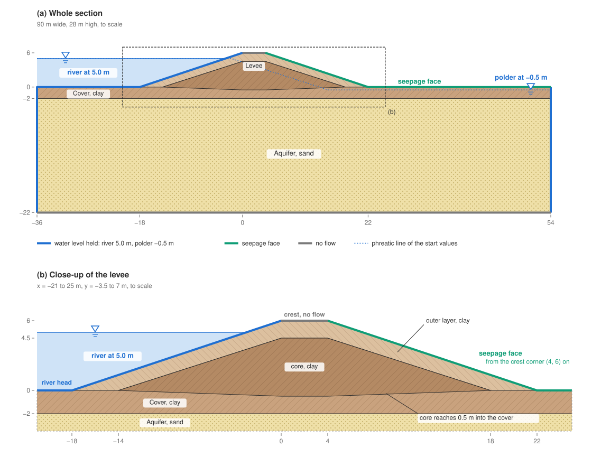

# Levee seepage, groundwater flow

A steady-state groundwater flow under and through a clay levee on a clay cover over a
sand aquifer. The river stands against the outer slope; the water flows to the polder
and leaves through the inner slope and the polder surface. The model is rebuilt from a
reference calculation of the same section, with the same geometry, soil properties and
boundary conditions, and its water pressures are compared with that calculation below.

| File | What it is |
|---|---|
| `levee_seepage.json` | The project file, as the GUI's **Save** and `kratos-cli new` write it |
| `levee_seepage.py` | The same model as a model script |

## The model



- **Section**: x from −36 to 54 m, y from −22 m up to the ground surface at 0 and the
  crest at 6 m, plane strain.
- **Soil**:
  - a sand aquifer from −22 to −2 m and a clay cover from −2 to 0 m, across the whole
    section;
  - a levee of clay, drawn as two polygons. The **core** runs from (−14, 0) over a crest
    at 4.5 m to (18, 0), and reaches 0.5 m into the cover. The **outer layer** wraps it,
    from (−18, 0) over the crest from (0, 6) to (4, 6) to (22, 0).
- **Flow properties**: all four bodies share them. The saturated hydraulic conductivity
  is 1 m/day, isotropic (an intrinsic permeability of 1.157e-12 m² with a water unit
  weight of 10 kN/m³). The retention curve is Van Genuchten, with ga = 3.83 1/m (an air
  entry pressure of 2.611 kPa), gn = 1.377, gl = 1.25, a residual saturation of 0.06203 and
  a lower limit on relative permeability of 1e-4.
- **Water**:
  - the left side, the river bottom and the dike outer slope up to the crest are held at a water
    level of 5.0 m (the river);
  - the right side is held at −0.5 m (the polder);
  - the inner slope and the polder surface are a seepage face, from the crest's inner
    corner (4, 6) on;
  - the crest, from (0, 6) to (4, 6), and the model's bottom have no condition, so no
    water flows through them.
- **Start values**: hydrostatic below a phreatic multi-line through (−36, 5), (−2, 5),
  (15, −0.5) and (54, −0.5): the river level up to just before the crest, dropping
  through the levee to the polder level. Above the line the suction is capped at 100 kPa,
  as on the river and polder heads.
- **Stages**: one stage, of the type **Groundwater flow**, with the seepage strategy, at
  most 300 iterations and a residual error tolerance of 1e-4.
- **Mesh**: linear, 1.0 m.

The river level holds on the outer slope above 5.0 m too, as in the reference
calculation: up to the crest the soil there is held in suction, 10 kPa at (0, 6).

## The results

The seepage strategy converges in 20 iterations. It opens the seepage face on the inner
slope from an exit point at x = 19.2 m (y = 0.95 m), and the whole polder surface beyond.

- The water that comes in from the river leaves on the polder side: 2.87 m³/day per
  meter, in and out. 2.03 of it leaves through the seepage face and 0.84 through the
  right side. None of it goes through the crest.

`flow_rate` (**Nodal water flow rate** in Results) is the water each node takes in
(negative) or lets out (positive), per meter of the section. Kratos' sign for the water
pressure is suction positive.

## In the Styx GUI

1. Open `levee_seepage.json` with **File > Open project…**, or type
   `run examples/levee_seepage/levee_seepage.py` in the command box.
2. Click **Calculate**.
3. In **Results**, show **Pore pressure**, **Hydraulic head**, **Effective saturation** or
   **Nodal water flow rate**.

## From the Styx command line

```bash
kratos-cli.bat check levee_seepage.json        # Windows; ./kratos-cli.sh on Linux, macOS, Git Bash
kratos-cli.bat calculate levee_seepage.json
kratos-cli.bat results field 1 pw
kratos-cli.bat results field 1 flow_rate
```

The model script writes the deck and runs it:

```bash
python levee_seepage.py --out deck/            # write the Kratos deck
python levee_seepage.py --calculate            # write the deck, run it, print the results
```

`python` is the environment `kratos-cli` runs in: `<repo>\.venv-windows\Scripts\python.exe`
on Windows, `<repo>/.venv-linux/bin/python` on Linux, where `<repo>` is the folder you
cloned the repository into.

[docs/cli_tutorials/levee_seepage_case.md](../../docs/cli_tutorials/levee_seepage_case.md)
builds this model command by command. The commands are all in
[docs/CLI.md](../../docs/CLI.md).
